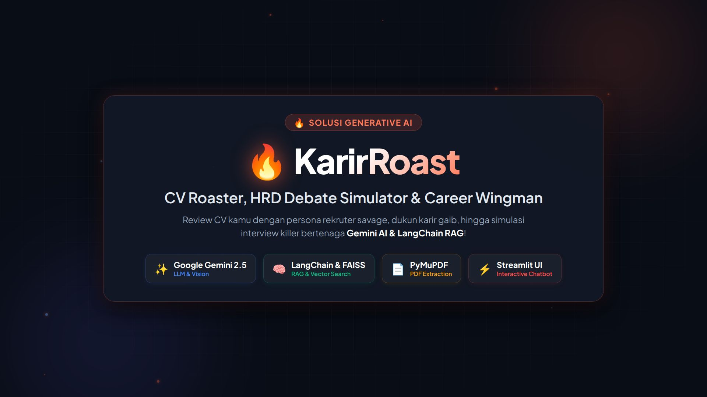

# 🔥 KarirRoast: CV Roaster, HRD Debate Simulator & Career Wingman

> **Fun Experimental Project** untuk me-roast CV dengan persona rekruter savage, dukun karir gaib, konsultan ATS, dan simulasi interview kerja bertenaga Generative AI & LangChain RAG.


---

## 🎬 Sneak peek

<div align="center">
  <video src="assets/KarirRoastPromo.mp4" poster="assets/promo_thumbnail.jpg" width="100%" controls style="border-radius: 12px; box-shadow: 0 10px 30px rgba(0,0,0,0.5);">
    <a href="assets/KarirRoastPromo.mp4">
      
    </a>
  </video>
  <p><em>📺 <strong>Tonton Video Promosi KarirRoast AI</strong>Jika pemutar tidak muncul di browsermu, <a href="assets/KarirRoastPromo.mp4">buka berkas MP4 langsung</a>.</em></p>
</div>

---

## 📌 1. Tentang KarirRoast

Banyak pelamar kerja bingung mengapa CV mereka jarang tembus screening HRD atau lolos filter ATS. Feedback dari recruiter pun seringkali normatif dan kaku.

**KarirRoast** hadir untuk mengubah proses review CV menjadi interaktif, menghibur, sekaligus berbobot teknis:

- **Bukan sekadar _one-shot roaster_**: Pengguna bisa **mendebat balik** AI di kolom chat secara interaktif. AI akan mencari bukti nyata dari isi CV kandidat menggunakan **RAG (Retrieval-Augmented Generation)** untuk mematahkan dalih pengguna.
- **Tough Love**: Di balik roasting pedas, AI menyediakan solusi konkret (revisi bullet point metode STAR, evaluasi ATS, dan simulasi interview).

---

## 🧠 2. Arsitektur & Teknologi AI

Proyek ini dibangun dengan memadukan teknologi modern LLM, RAG, dan UI interaktif:

| Komponen                        | Teknologi                          | Implementasi                                                                                                                                                                                                                               |
| :------------------------------ | :--------------------------------- | :----------------------------------------------------------------------------------------------------------------------------------------------------------------------------------------------------------------------------------------- |
| **Multimodal & LLM Foundation** | Google Gemini (`google-genai` SDK) | • Ekstraksi dokumen PDF CV (`PyMuPDF`)<br>• Dynamic Persona & System Instructions<br>• Temperature tuning berdasarkan level kepedasan roast (Mild, Spicy, Extra Hot)                                                                       |
| **RAG & Vector Search**         | LangChain & FAISS                  | • Chunking dokumen dengan `RecursiveCharacterTextSplitter`<br>• Embeddings mutakhir dengan `gemini-embedding-2` (MRL 768 dimensi)<br>• Vektorisasi in-memory dengan `FAISS`<br>• Context retrieval untuk pembuktian klaim kandidat di chat |
| **User Interface & State**      | Streamlit                          | • Chatbot interaktif multi-turn dengan streaming respons real-time<br>• State persistence (`st.session_state`) untuk chat, vectorstore, dan evaluasi<br>• Custom modern dark UI layout                                                     |

---

## 🎭 3. Persona AI yang Tersedia

Setiap persona membawa sudut pandang, kepribadian, dan gaya interaksi yang berbeda. Pemilihan persona ini secara dinamis mempengaruhi analisis di **Instant Roasting**, lawan bicara di **Arena Baku Hantam (Chat)**, hingga perspektif penilaian di **Job Description Matcher**:

1. 😈 **HRD Savage (Roaster & Debat):**
   - Recruiter senior yang lelah membaca puluhan ribu CV klise dan penuh buzzword kosong.
   - Siap baku hantam di chat jika pengguna membela diri, namun tetap memberikan _Tough Love_ (solusi perbaikan konkret metode STAR) jika diminta dengan tulus.
   - Memiliki **3 Tingkat Kepedasan**: _Level 1 (Mild / Sindir Sopan)_, _Level 2 (Spicy / HRD Jaksel Julid)_, dan _Level 3 (Extra Hot / Neraka Jahanam Tanpa Ampun 🔥)_.

2. 🔮 **Dukun Primbon Karir (Mbah Broto):**
   - Konsultan gaib HRD & pembaca aura spiritual rezeki kandidat.
   - Menganalisis CV dari kacamata weton teknologi, perseteruan khodam programming (contoh: khodam Python bentrok dengan CSS), dan aura jodoh industri (startup bakar duit, korporat birokratis, atau jualan seblak).
   - Memberikan saran "ruwatan karir" agar berkas pengguna terhindar dari santet penolakan ATS.

3. 👔 **Konsultan ATS & Karir Pro:**
   - Evaluasi formal berstandar internasional tanpa sindiran atau sarkasme.
   - Memberikan Skor Keterbacaan ATS (0–100) dengan justifikasi teknis, 3 kelemahan format/action verbs, audit metode STAR, dan rekomendasi perbaikan sebelum-sesudah (_Before vs After rewrite_).

4. 🥊 **Interviewer Muka Tembok:**
   - Simulasi wawancara kerja killer ala VP of Engineering yang berwajah dingin dan kritis.
   - Mengajukan satu pertanyaan paling menjebak per giliran berdasarkan kelemahan CV, serta menyusun lembar audit screening teknis objektif pada Job Matcher.

---

## 🚀 4. Fitur Utama Aplikasi

- **💥 Instant Roasting & Audit:** Metrik skor instan, first impression, 3 dosa terbesar, prediksi nasib CV, dan rekomendasi penyelamat.
- **💬 Arena Baku Hantam (Interactive Chat & RAG):** Chat multi-turn yang dilengkapi tombol expander untuk melihat bukti potongan CV yang ditemukan oleh vektor FAISS.
- **🎯 Job Description Matcher:** Bandingkan CV dengan kualifikasi lowongan kerja riil untuk melihat skill gap dan persentase kelolosan.
- **📄 Preview Teks CV:** Verifikasi hasil ekstraksi per halaman dari dokumen yang diunggah.
- **⚡ Instant Demo:** Menyediakan opsi _"Gunakan Contoh CV"_ sehingga demo dapat langsung dicoba tanpa perlu repot mencari file PDF.

---

## 🛠️ 5. Cara Instalasi & Menjalankan

### Prasyarat:

- Python 3.10+
- Google AI Studio API Key (dapat diperoleh gratis di [aistudio.google.com/app/apikey](https://aistudio.google.com/app/apikey))

### Langkah-langkah:

1. Clone repository dan masuk ke direktori proyek:

   ```bash
   git clone https://github.com/rayasya/KarirRoast.git
   cd KarirRoast
   ```

2. Buat dan aktifkan virtual environment:
   - **Linux / macOS:**
     ```bash
     python3 -m venv .venv
     source .venv/bin/activate
     ```
   - **Windows:**
     ```cmd
     python -m venv .venv
     .venv\Scripts\activate
     ```

3. Install seluruh pustaka (dependencies):

   ```bash
   pip install --upgrade pip
   pip install -r requirements.txt
   ```

4. Jalankan aplikasi Streamlit:

   ```bash
   streamlit run app.py
   ```

5. Buka tautan lokal yang ditampilkan di terminal (biasanya `http://localhost:8501`), lalu masukkan **Google AI Studio API Key** Anda di sidebar aplikasi. Model Gemini akan otomatis dimuat secara dinamis dari API Key Anda sehingga Anda dapat memilih model yang diinginkan (`gemini-2.5-flash`, `gemini-2.0-flash`, `gemini-1.5-flash`, dll.).

---

## 📁 6. Struktur Direktori Proyek

```
KarirRoast/
├── assets/                     # Video demo promosi & aset grafis
│   ├── KarirRoastPromo.mp4    # Video promosi
│   └── promo_thumbnail.jpg    # Cover poster thumbnail
├── .venv/                      # Virtual environment lokal
├── core/
│   ├── __init__.py
│   ├── pdf_loader.py          # Ekstraktor teks & metadata PDF (PyMuPDF)
│   ├── personas.py            # Prompt persona & system instructions
│   ├── rag_engine.py          # Vektorisasi FAISS & Retriever chunk
│   └── gemini_service.py      # Integrasi Google GenAI API client
├── sample_cv.pdf              # Sampel CV untuk demonstrasi instan
├── app.py                     # Antarmuka web Streamlit utama
├── requirements.txt           # Daftar pustaka yang digunakan
├── .gitignore                 # Filter file rahasia & venv
└── README.md                  # Dokumentasi proyek
```
